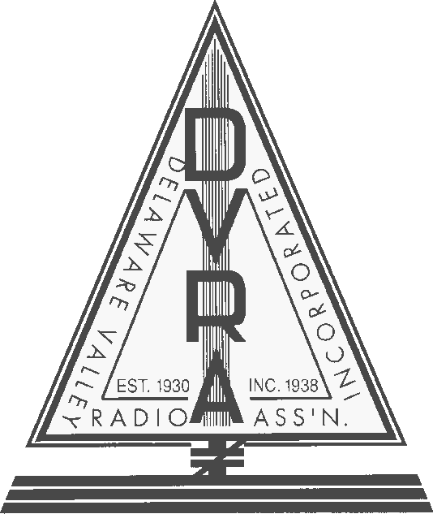

# StationVoice

  

**StationVoice** is a software-based announcement system for 
<a href="https://en.wikipedia.org/wiki/Amateur_radio_repeater" target="_blank">Amateur Radio repeaters</a>. 
It combines scheduled announcements, text-to-speech (TTS), audio playback, and radio control in a local-network application managed via web browser.

Developed for the <a href="https://w2zq.com" target="_blank">Delaware Valley Radio Association (DVRA)</a>, StationVoice was designed to transmit announcements across multiple repeaters while offering more natural speech and flexible scheduling than other announcement controllers, and centralized administration.

## Why StationVoice?

Traditional repeater announcement systems often rely on fixed phrases, recordings, and limited scheduling options. StationVoice uses text-to-speech to generate announcements from editable text, manages schedules through a web interface, and can transmit through multiple radio interfaces.

At the DVRA, the system is used to transmit the same scheduled announcements to two repeaters at the same time, each using its own radio and interface.

## Features

- **Multi-radio operation:** Control multiple radios using an individual <a href="https://www.masterscommunications.com/products/radio-adapter/dra/dra36m.html" target="_blank">Masters Communications DRA-36M interface</a> for each radio.

- **Text-to-speech:** Generate speech using <a href="https://github.com/OHF-Voice/piper1-gpl" target="_blank">Piper TTS</a> directly in StationVoice without having to create or maintain recordings for ordinary announcements. Supports a range of voices (any voice usable by Piper TTS).

- **Web administration:** Manage announcement text, schedules, settings, and users from a browser on the local network (run StationVoice on a physically small computer in the repeater cabinet, without needing a monitor and a keyboard there).  Access remotely via VPN.

- **Flexible schedules:** Use baseline schedules and overlays for recurring events, special announcements, and time-specific programming.

- **Audio announcements:** Supports audio-file announcements in addition to synthesized speech.

- **Amateur Radio Newsline:** Automatically retrieves and prepares weekly <a href="https://www.arnewsline.org/" target="_blank">Amateur Radio Newsline</a> reports, with story-aware segmentation for transmission without hitting your repeater's timeout.

- **Channel-aware operation:** Monitor activity on the repeater's output frequency, and defer transmissions when busy.

## What StationVoice is Not
StationVoice is not a Repeater Controller. It does **not** provide the FCC-mandated station ID which is required at least every 10 minutes during active communications. This is typically the job of a Repeater Controller. In fact, if your repeater is fairly inactive, your repeater controller is likely to play it's station ID immediately after one of StationVoice's announcements finishes.

## How it works

StationVoice runs on a Linux computer and uses a local web application to manage announcements and schedules. At the scheduled times, the application prepares the announcement and sends audio to a radio via a DRA-36M interface. The radio transmits on the repeater's input frequency, and listens on the repeater's output frequency to determine when the repeater is "Busy".

See [Architecture](docs/architecture.md) for an overview.

## Getting started

StationVoice is developed and tested on macOS without radio hardware and on 64-bit Linux for radio operation.
It makes no effort to be compatible with othe operating systems, and likely will not work on anything that is not Linux-compatible.

See these links for installing the hardware and software to run StationVoice:

- [Installation and first run](docs/getting-started.md)
- [Hardware and radio setup](docs/final-hardware/README.md)
- [Radio backend details](docs/radio-backend.md)

## User documentation

| Topic | Description |
|---|---|
| Creating Announcement | How to create text (TTS) and Audio (mp3) Announcements
| [Scheduling announcements](docs/how-to-schedule.md) | Baselines, overlays, recurring schedules, and timing |
| [Amateur Radio Newsline](docs/arnewsline.md) | Downloading, processing, and transmitting Newsline |

## Developer documentation

| Topic | Description |
|---|---|
| [Architecture](docs/architecture.md) | Application components and data flow |
| [Development](docs/development.md) | Development environment, tests, and quality checks |
| [API overview](docs/api-overview.md) | HTTP API overview |

## Status

StationVoice is an evolving project. The production radio configuration and hardware verification documented in this repository reflect testing at the DVRA.

## License

StationVoice is licensed under the **GNU General Public License v3.0 or later**. See [LICENSE](LICENSE).
